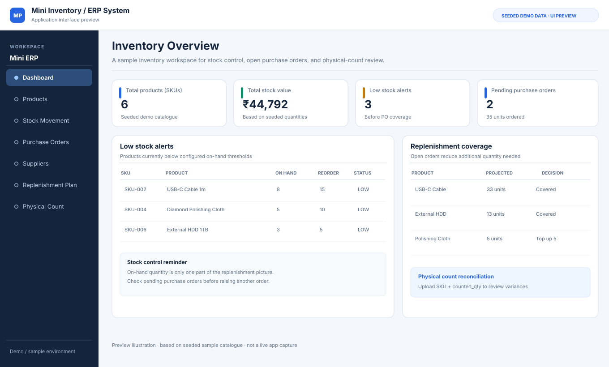

# Mini Inventory / ERP Management System

A small Streamlit inventory prototype built around three practical operations problems: maintaining stock records, avoiding redundant replenishment when stock is already on order, and reconciling physical counts with the system ledger.

## Interface Preview (Illustrative)

> Illustrative interface preview based on the seeded sample catalogue and replenishment logic. This is not a screenshot captured from a running instance.

> **Scope:** This is a portfolio and learning project, not a replacement for a production ERP. It uses synthetic/demo records and does not forecast demand, model supplier lead times, or support multi-warehouse allocation.

## Problems addressed

- Stock levels and supplier relationships can become difficult to track in spreadsheets.
- Simple low-stock alerts can be noisy: an item may appear below its threshold even though a pending purchase order is already on the way.
- Physical stocktakes often need a manual comparison between a counted quantity and the quantity recorded in the system.
- Stock corrections and purchase receipts need a clear movement log, and an accidental double-click should not add the same purchase order twice.

## Current features

- Maintain products, suppliers, purchase orders, and stock IN/OUT movements in SQLite.
- Display stock value, pending purchase orders, and stock below configured thresholds.
- **Replenishment planning:** includes quantities on pending purchase orders before calculating whether there is still a shortfall to the configured threshold. This helps avoid duplicate reorder suggestions for already-covered items.
- **Physical count reconciliation:** download a CSV template, upload a physical-count CSV or Excel file with `sku,counted_qty`, and compare counted quantities with system stock.
- Calculate quantity variances and a signed variance value at unit price to prioritise manual investigation.
- Highlight unknown SKUs and reject duplicate SKUs, blank SKUs, negative counts, non-integer counts, and invalid quantities.
- Post an approved physical count as a stock adjustment only after an explicit confirmation. Every adjustment is recorded as a stock movement with a note.
- Prevent stock-out transactions from taking on-hand stock below zero.
- Mark a purchase order as received only once, updating stock and the movement log atomically.
- Include automated tests for the count-review rules, replenishment logic, and key stock-control safeguards.

## Tech stack

- Python
- Streamlit
- pandas
- SQLite
- pytest

## Run locally

Create and activate a virtual environment, then install dependencies:

    python -m venv .venv

    # Windows PowerShell
    .\.venv\Scripts\Activate.ps1

    # macOS / Linux
    source .venv/bin/activate

    python -m pip install -r requirements.txt
    python seed_data.py
    streamlit run app.py

The seed script recreates the local demo database with three suppliers, six products, and two pending purchase orders.

## Physical count file format

The input file must contain these columns:

    sku,counted_qty
    SKU-001,44
    SKU-002,8

The app compares each count with current system stock. Unknown SKUs appear as review exceptions and block applying the batch until the uploaded file is corrected. Before posting any adjustment, inspect the count and variance: a variance is a signal to investigate, not evidence of loss or wrongdoing. Confirm whether receipts, sales, returns, damage, unit conversions, or data-entry mistakes explain the difference.

A template based on the current product catalogue is available from the Physical Count tab.

## Replenishment planning rules

For each product:

- Projected quantity = on-hand quantity + quantities on pending purchase orders.
- Additional quantity to reach threshold = the non-negative gap between the projected quantity and the configured reorder threshold.
- A pending purchase order that already covers the threshold is surfaced as coverage rather than another suggested reorder.

This is a basic threshold-based planning aid, not demand forecasting. It does not include average daily sales, lead time, seasonality, safety-stock policy, supplier constraints, or purchase pack sizes.

## Tests

Run:

    python -m pytest -q

GitHub Actions runs the same test suite on pushes and pull requests.

## Why I built it

I wanted to model the practical controls behind an inventory workflow, not just create an add/edit/delete dashboard. The cycle-count feature connects physical observations with system quantities, while the replenishment workbench demonstrates how operational context—especially stock already on order—changes a simple alert into a more useful review queue.

## Limitations and responsible use

- Use synthetic data for demos; do not publish private supplier or business records.
- Review stock variances before posting adjustments.
- The project does not include authentication, role permissions, concurrency testing across multiple users, backups, or production deployment hardening.
- The configured reorder threshold is an input to the demo, not a guaranteed service-level or demand recommendation.
